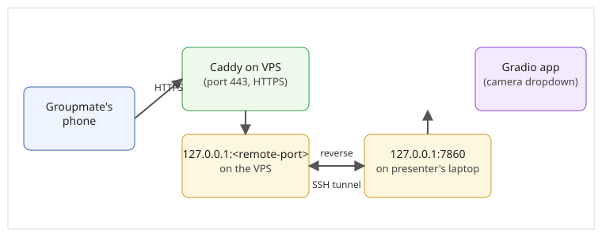

# How the midterm demo was presented live over Google Meet

This documents how we presented the object-sorting demo for the midterm:
one presenter runs the Gradio app locally and screen-shares it in Google
Meet, while groupmates join from their own homes and use their **phones**
as the camera source. Each groupmate points their phone at a different
everyday object, which gave the demo varied real-world viewpoints,
backgrounds, and lighting without anyone needing to bring physical props
to one location. Each groupmate opens the app's **Phone camera** tab and
enters their name once; the presenter switches between them from a
device dropdown in the app's **Presenter** tab (see
[`src/vision/README.md`](../src/vision/README.md)) to flip between phones
live, on screen, for everyone on the call.

This is a description of how that one session was run, not a plan for
permanent infrastructure — there's no dedicated hardware or server for
this project; it borrowed a VPS someone already had running for something
else, for the duration of the demo.

## Why phones need HTTPS

Browsers only grant camera access (`getUserMedia`) to a page served over
HTTPS (or `localhost`). A phone on a groupmate's home network opening the
presenter's laptop over plain HTTP would get the camera permission
silently denied. So the Gradio app's local URL had to be reachable over
**HTTPS** from the open internet, not just on the presenter's own LAN.

## How it worked: a reverse SSH tunnel through a cloud VPS

The presenter's Gradio app only listens on `127.0.0.1:7860` on their own
laptop — it was never exposed directly to the internet. Instead:

<p align="center"><br><sub>Figure 1. A phone's HTTPS request reaches Caddy on the VPS, which hands off through the reverse SSH tunnel to the Gradio app on the presenter's own laptop.</sub></p>

1. **A small cloud VPS** (`<vps-ip>`) already ran [Caddy](https://caddyserver.com/)
   as its web server/reverse proxy for other things.
2. We gave the VPS a hostname via **sslip.io**, a free DNS service that
   maps `<ip-with-dashes>.sslip.io` to that IP automatically — no DNS
   registrar or manual records needed. Caddy requests a Let's Encrypt
   certificate for that hostname **on demand**, the first time it's
   visited, which is what makes it serve valid HTTPS with zero manual
   cert setup.
3. Caddy was given one extra site block that reverse-proxies that
   hostname to a local port on the VPS, e.g.:
   ```caddy
   demo.<ip-with-dashes>.sslip.io {
       reverse_proxy 127.0.0.1:<remote-port>
   }
   ```
4. From the presenter's laptop, a **reverse SSH tunnel** opened that local
   port on the VPS and pointed it back at the laptop's own `127.0.0.1:7860`:
   ```
   ssh -i <path-to-key> \
       -N \
       -R 127.0.0.1:<remote-port>:127.0.0.1:7860 \
       -o ServerAliveInterval=15 \
       -o ServerAliveCountMax=3 \
       -o ExitOnForwardFailure=yes \
       <user>@<vps-ip>
   ```
   The forwarded port was bound to `127.0.0.1` **on the VPS**, not
   `0.0.0.0` — so it was only reachable through Caddy's HTTPS front door,
   never directly.
5. While that SSH session stayed open, `https://demo.<ip-with-dashes>.sslip.io`
   resolved to the laptop's Gradio app, with a valid HTTPS certificate, from
   anywhere on the internet. Groupmates opened that one link on their
   phones; the presenter picked each phone from the camera dropdown in the
   Gradio UI and showed it live on the shared screen.
6. As soon as the SSH session was closed, the tunnel disappeared and the
   URL stopped resolving to anything — nothing was left running after the
   demo.

A short wrapper script kept the `ssh` command above alive and reconnected
it automatically if the connection dropped (keepalives +
`ExitOnForwardFailure=yes` so a dead tunnel fails fast and retries,
instead of hanging silently).

## Tuning the live frame rate

The Phone camera stream interval and the Presenter refresh interval are
configurable via environment variables, in case the venue's network or the
presenter's CPU needs a different budget than the defaults:

| Variable | Default | What it controls |
|---|---|---|
| `PHONE_STREAM_INTERVAL_S` | `0.2` (~5 fps) | Minimum seconds between frames a phone sends up. Lower = smoother but more CPU/network load. |
| `PRESENTER_REFRESH_S` | `0.2` | How often the Presenter tab's dropdown and display re-render. |

Example, for a slower connection:

```bash
PHONE_STREAM_INTERVAL_S=0.5 PRESENTER_REFRESH_S=0.5 python src/vision/app.py
```

A single in-memory lock ensures only one frame is classified at a time
across all connected phones; if a new frame arrives while the previous one
is still being classified, it is dropped rather than queued, so the demo
stays responsive instead of building up a backlog under load.

## Security notes

- While the tunnel was open, the URL was reachable by **anyone on the
  internet** who had the link — there was no authentication in front of
  it. It was shared only in the Google Meet chat for the session, not
  posted anywhere more permanent.
- The VPS only exposed one new hostname/port for this; nothing else on
  that box was touched.
- The forwarded port was always bound to loopback (`127.0.0.1`) on the
  VPS side, never to all interfaces, so it could not be reached except
  through Caddy's HTTPS proxy.

## Experimental: a real-time WebRTC version

Alongside the JPEG-frame approach above, there is an experimental version at
`src/vision/webrtc_app.py` that streams phone video over **WebRTC**
(using the FastRTC library) instead of individual uploaded frames, aiming
for smoother live video for the Presenter view during screen-share. It is
not the primary demo; it was only switched to if it proved reliable on
real phones.

It reuses the same reverse-SSH-tunnel-plus-Caddy pattern described above,
on its own separate port and hostname, so it never competes with or
disturbs the primary demo's tunnel or Caddy site block.

WebRTC needs to negotiate a peer-to-peer (or relayed) connection between
each phone and the presenter's desktop, which plain HTTPS reverse-proxying
does not handle by itself:

- A public **STUN** server (`stun:stun.l.google.com:19302`) is tried first,
  which is enough when at least one side has a normal, non-restrictive
  network path.
- Phones and home networks behind strict NAT or carrier-grade NAT may still
  fail to connect over STUN alone; a **TURN** relay would be needed for
  those cases. This demo reads an optional environment variable for a
  free TURN credential helper, used only if one is ever configured; with
  none set, it falls back to STUN only, and simply shows a message
  pointing back at the primary demo link if a phone can't connect.

## Troubleshooting notes (for next time)

- **502 Bad Gateway** from the hostname means Caddy can reach the VPS but
  nothing is listening on the forwarded port there — the SSH tunnel isn't
  up, or the local Gradio app isn't running on `127.0.0.1:7860`. Start the
  Gradio app first, then the tunnel.
- **Certificate warnings** usually mean the hostname was just visited for
  the first time and Caddy is still obtaining the certificate — wait a few
  seconds and reload.
- **Tunnel drops mid-call**: the reconnect loop/keepalives should recover
  it within a few seconds; if not, check the presenter's own network
  connection.
